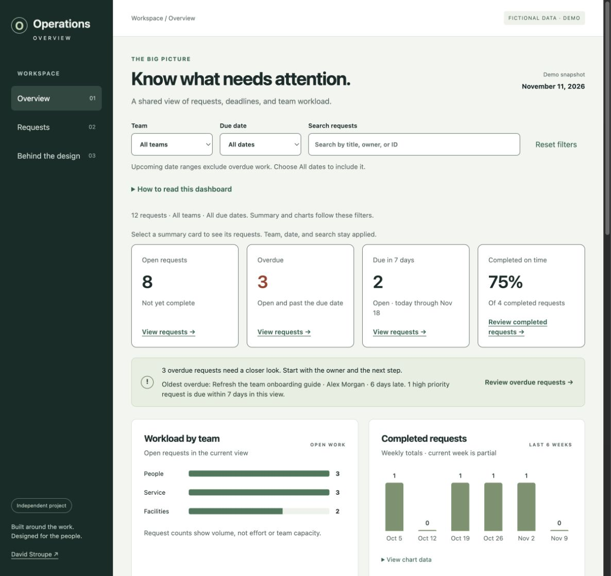

# Operations Overview

I wanted a dashboard project I could actually share. This is an independent concept for a manager who needs to see what is overdue, what is coming up, and who owns the next step.

[Try the dashboard](https://dnstroupe.github.io/operations-overview/) · [Read the case study](https://dnstroupe.github.io/operations-overview/case-study.html) · [Open the editable Figma design](https://www.figma.com/design/buTSTCAfzuZun0weL3j43a)



## What you can do

Choose a team, narrow the due dates, or search for a request. The summary and charts follow those filters. Use the status buttons to narrow the list, open a request to see its context and next step, or export the current view as a CSV.

The layout adapts to a phone. Requests become labeled cards so the details stay readable.

## What this project shows

Information hierarchy, dashboard design, responsive layouts, reusable Figma elements, and the small decisions that make numbers easier to understand. For example, an open request count is not the same thing as team capacity. The interface makes that distinction.

## What is real

The design and working application are real project artifacts. All 12 requests, people, teams, dates, and dashboard numbers are fictional. This is not a client deployment or a recreation of a government system. I have not conducted user research or measured business results for this concept.

I brought the operational perspective and chose the project direction. I am reviewing and developing the project as part of my growing UX practice.

## The package

* `case-study.html` explains the problem, choices, and what I want to test next.
* `DESIGN.md` walks through the design process and open questions.
* `DATA.md` explains the synthetic data and calculations.
* `CHECKS.md` records checks and remaining accessibility work.
* `ROADMAP.md` gives me a manageable way to keep improving it.
* The Figma file includes editable desktop and mobile layouts and reusable metric cards.

## Run it locally

No install or build step is needed. From this folder, run:

```sh
python3 -m http.server 8000
```

Then open http://localhost:8000. Run the calculation checks with `node test-data.cjs`.

Built with Figma, HTML, CSS, JavaScript, and GitHub Pages. There is no backend, sign in, analytics, or connection to a work system.

## What changed after review

The default view now puts unresolved work first. Overdue requests keep their work status, the demo date stays visible on phones, and the export includes schedule context. The case study shows the decisions and a real review iteration, including what remains untested.

* [Read the readiness review](AUDIT.md)
* [Use the usability session plan](TEST-PLAN.md)
* [Review accessibility and remaining checks](https://dnstroupe.github.io/operations-overview/accessibility.html)

The Figma file also includes detail and empty states, review notes, and editable metric properties. It is a design study with a working browser counterpart, not a complete enterprise design system.

## A quicker leadership review

The KPI cards now open their matching request lists. Summary totals stay tied to team, date, and search. The active list filter is named and can be cleared without losing those choices. The briefing calls out the oldest overdue request and upcoming high priority work. Each row shows its next step, overdue age, or completion timing. These changes are intended to reduce extra clicks; no user outcome or time savings are claimed.
